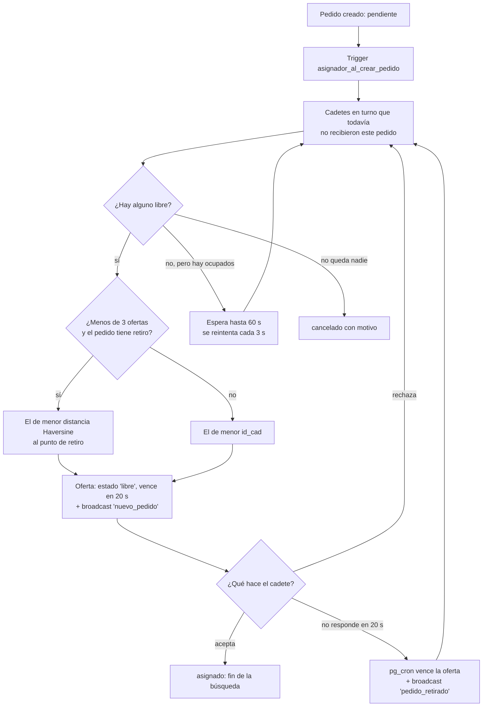

# Asignación de pedidos por cercanía

Cómo el asignador elige a qué cadete ofrecerle un pedido nuevo. Desde el 15/11/2026 el asignador corre **en el
servidor** (funciones de Postgres + pg_cron, `supabase/migrations/20261115100000_asignador_en_servidor.sql`), no
en el navegador del cliente. La especificación completa (estados, funciones, canales) está en
[`contrato_app_cadetes.md`](contrato_app_cadetes.md), sección 7; acá se explica la regla de cercanía y lo que
hay que saber para mantenerla.

---

## La regla en tres líneas

1. El pedido se ofrece **a un solo cadete por vez**, primero al **cadete libre más cercano al punto de retiro**.
2. Después de **3 ofertas sin aceptar** (rechazo o sin respuesta) se sigue ofreciendo **sin tener en cuenta la
   distancia**, en orden de `id_cad`.
3. Solo cuentan los cadetes **en turno**: los que mandaron su señal en los últimos 75 segundos y no están
   `desconectado`. Un cadete que cerró la app sin "Finalizar Turno" deja de mandar señal y se descarta solo.

---

## Paso a paso



1. **El pedido nace `pendiente`**, sin cadete (`crear_pedido.html`). El trigger `asignador_al_crear_pedido` llama
   a `asignador.revisar(id_pedido)` en la misma transacción del alta.
2. **Cadetes en turno**: los que tienen una fila en `cadetes_senal` con `ultima_senal` de los últimos 75 s,
   `estado_cad` en `disponible` / `en_confirmacion` / `ocupado`, y ninguna fila en `ofertas_pedido` para este pedido.
3. **Libre** = `estado_cad = 'disponible'` y sin ningún pedido a su nombre en `libre`, `en_confirmacion`,
   `asignado` o `en_camino_entrega`. El resto de los que están en turno cuentan como **ocupados**.
4. **Elige al cadete libre:**
   - **Por cercanía** (mientras el pedido lleve menos de 3 ofertas y tenga coordenadas de retiro): el de menor
     distancia al retiro. Los que no tienen ubicación real quedan al final. A igual distancia gana el menor `id_cad`.
   - **Sin distancia**: el de menor `id_cad`.
5. **Oferta**: `id_cadete = X`, `estado_pedido = 'libre'`, `oferta_vence_en = ahora + 20 s`, una fila en
   `ofertas_pedido` (con `distancia_km` y `por_cercania`) y un broadcast `nuevo_pedido` a `pedidos-cadete-X`.
6. **Respuesta del cadete**:
   - Acepta (`cadete_aceptar_pedido`) → `asignado`, termina la búsqueda.
   - Rechaza (`cadete_rechazar_pedido`) → en la misma llamada se ofrece al siguiente.
   - No responde → el latido (`asignador.tick`, cada 3 s) vence la oferta, le manda `pedido_retirado` para
     cerrarle el modal y ofrece al siguiente.
7. **Si no queda nadie libre**: primero intenta **encolarlo** a un cadete en viaje (ver "La cola por cadete").
   Si tampoco se puede y hay ocupados que todavía pueden tomarlo, espera hasta 15 min (`espera_desde`);
   si no, cancela con el motivo: "No hay cadetes conectados", "Todos los cadetes rechazaron el pedido" o
   "Ningún cadete se liberó a tiempo".

---

## La cola por cadete

Cuando no hay ningún cadete libre, el pedido no espera a ciegas: se le ofrece a un cadete que está en viaje, para
que lo haga apenas termine (`supabase/migrations/20261116090000_cola_por_cadete.sql`).

- **A quién:** al cadete en viaje que va a quedar más cerca. La distancia se mide **desde el destino de su viaje
  actual** (`latitud_dest`, `longitud_dest` del pedido que lleva) **hasta el retiro del pedido nuevo**. No importa
  dónde está parado ahora, sino dónde va a entregar.
- **Quién es encolable:** en turno, con un viaje (`asignado` o `en_camino_entrega`), sin una oferta abierta, sin
  otro pedido en cola y al que este pedido nunca se le ofreció.
- **La oferta es igual a las demás** (20 s, `ofertas_pedido.para_cola = true`). En la app del cadete aparece como
  "Siguiente pedido" durante el viaje (`Scripts/cola_cadete.js`).
- **Si acepta:** el pedido pasa a `en_cola` a su nombre. Al entregar el viaje, pasa solo a `asignado`.
- **Si rechaza o no responde:** se prueba con el siguiente cadete en viaje. El rechazo de una oferta de cola no lo
  descarta: cuando quede libre, el pedido se le puede ofrecer normalmente.
- **Un cadete libre siempre va antes** que encolar.
- **15 minutos en cola como máximo:** si el cadete no terminó su viaje, el pedido vuelve a la búsqueda.
- El cliente puede cancelar mientras está en cola.

---

## De dónde sale la ubicación de cada cadete

Cada cadete en turno manda un **latido** cada 15 s con la función `cadete_latido(p_id_cad, p_lat, p_lng, p_gps_ms)`
(`SistemaCadetes/Scripts/latido_cadete.js`). Se guarda en la tabla `cadetes_senal`:

| Columna | Qué es |
|---|---|
| `id_cad` | id del cadete (una fila por cadete) |
| `ultima_senal` | hora del servidor del último latido |
| `lat`, `lng` | última ubicación real |
| `ubicacion_en` | hora del último fix GPS real. **`null` si el cadete todavía no tiene GPS o no dio permiso** |

El asignador **solo mide distancia si `ubicacion_en` no es null**. Así un cadete sin GPS no "gana" pedidos con
una ubicación por defecto: recibe ofertas, pero después de los que tienen ubicación.

`cadetes_senal` tiene seguridad por filas y ningún permiso para las apps: los clientes **no pueden ver** dónde
están los cadetes. La app de cadetes sigue publicando además su ubicación por Realtime Presence en
`cadetes-disponibles`, pero eso lo usa solo el radar del panel de admin; el asignador no lo mira.

El latido se manda en el dashboard, en Rendición/Historial y **durante un viaje**. Por eso un cadete en viaje
cuenta como ocupado y un pedido nuevo espera a que se libere en vez de cancelarse.

---

## Quién cuenta como conectado

- Con señal en los últimos **75 s** y `estado_cad` distinto de `desconectado`.
- El latido sale cada 15 s; se toleran 75 s porque con la app en segundo plano el navegador puede demorar los
  temporizadores hasta un minuto.
- Si el cadete cierra la app o se queda sin red sin tocar "Finalizar Turno", su fila en `Cadetes` puede quedar
  en `disponible` u `ocupado`, pero deja de llegar la señal y a los 75 s el asignador lo descarta.
- Consecuencia: a un cadete que acaba de cerrar la app se le puede llegar a ofrecer un pedido durante ese
  minuto. La oferta vence sola a los 20 s y pasa al siguiente.

---

## La distancia

- Fórmula de **Haversine** (radio medio de la Tierra 6371 km), en `asignador.distancia_km`: distancia **en
  línea recta**, no por calles.
- Se mide **desde la ubicación del cadete hasta el punto de retiro** (`latitud_org`, `longitud_org`), porque
  es adonde tiene que ir primero.
- Si el pedido no tiene coordenadas de retiro, no se puede medir y se ofrece por `id_cad`.

---

## Qué cuenta para pasar a "sin distancia"

Cuenta **toda oferta de ese pedido que no terminó aceptada**, es decir, las filas de `ofertas_pedido`:

| Situación | Resultado en `ofertas_pedido` |
|---|---|
| El cadete toca "Rechazar", o vence su modal de 15 s | `rechazada` |
| El cadete acepta pero ya tenía un viaje en curso (dashboard en dos pestañas) | `rechazada` |
| No responde en 20 s | `vencida` |
| El cliente cancela, o la búsqueda vence a los 30 min | `retirada` (termina la búsqueda) |

Al llegar a 3 filas, las ofertas siguientes se hacen por `id_cad` (`por_cercania = false`). El conteo vive en
la base: no se pierde si el cliente recarga o cierra la app.

---

## Casos especiales

| Caso | Qué pasa |
|---|---|
| Cadete sin permiso de GPS o sin señal de GPS todavía | Recibe ofertas igual, pero después de los que tienen ubicación |
| Cadete que cerró la app sin "Finalizar Turno" | A los 75 s sin señal se descarta: no cuenta ni como libre ni como ocupado |
| Ningún cadete libre, pero hay cadetes en viaje | Se le ofrece a uno para su cola. Si nadie lo encola, espera hasta 15 min; apenas uno se libera (a lo sumo 3 s después) recibe la oferta |
| Nadie en turno | Se cancela al instante: "No hay cadetes conectados" |
| Varios pedidos al mismo tiempo | Las decisiones pasan de a una (bloqueo en la base): el segundo pedido ve que el cadete más cercano ya tiene una oferta y va al siguiente. Un cadete nunca tiene dos ofertas a la vez |
| El cadete acepta justo cuando vence la oferta | Gana el que llega primero a la base; el otro ve "ya no está disponible" o el modal cerrado |
| El cliente cierra la app | La búsqueda sigue. Al aceptar un cadete le llega el aviso push |
| Búsqueda de más de 30 min (`Pedidos.creado_en`) | Se cancela: "La búsqueda de cadete venció" |

---

## Configuración

Los plazos están escritos en las funciones de la migración (no hay tabla de configuración). Para cambiar uno
hay que hacer una migración nueva que reemplace la función:

| Qué | Valor | Dónde |
|---|---|---|
| Ofertas sin aceptar antes de ignorar la distancia | `3` | `asignador.ofrecer_siguiente` |
| Tiempo para que el cadete responda | 20 s | `asignador.ofrecer_siguiente` y `asignador.revisar`. Tiene que ser **mayor** que el modal del cadete (15 s) |
| Latido del servidor | 3 s | pg_cron, tarea `asignador-tick` |
| Espera a que se libere un cadete (nadie libre ni encolable) | 15 min | `asignador.ofrecer_siguiente` |
| Tiempo máximo en la cola de un cadete | 15 min | `asignador.revisar` |
| Vencimiento de una búsqueda | 30 min | `asignador.revisar` |
| Señal del cadete: cada cuánto / tolerancia | 15 s / 75 s | `Scripts/latido_cadete.js` / `asignador.ofrecer_siguiente` |

La app de clientes repite 20 s, 15 min y 30 min en `scripts/busqueda_pedido.js`, solo para mostrar las cuentas
regresivas: si se cambian en el servidor, cambiarlos también ahí.

---

## Qué ve el cliente

La app de clientes no decide nada: arma el texto con `textoBusqueda(pedido)` a partir de la fila del pedido.

| Momento | Título | Detalle |
|---|---|---|
| Oferta enviada (`libre`) | Ofreciendo a {nombre} | Enviando oferta • 18s |
| El cadete la está viendo (`en_confirmacion`) | Ofreciendo a {nombre} | Viendo la oferta • 12s |
| Todos ocupados (`pendiente` con `espera_desde`) | Todos los cadetes están ocupados | Te asignamos uno apenas se libere • esperamos hasta 12 min más |
| En la cola de un cadete (`en_cola`) | {nombre} está terminando otra entrega | Sos el siguiente: va a retirar tu pedido apenas termine |
| Entre ofertas | Buscando cadete | Estamos ofreciendo tu pedido a los cadetes disponibles |

El cliente ya no ve la distancia del cadete ni el número de intento: esos datos quedan en `ofertas_pedido`.

---

## Lo que tiene que cumplir la app de cadetes

Además del contrato general (sección 7.6 de `contrato_app_cadetes.md`):

- **Mandar el latido** mientras está en turno, con la ubicación real cuando la tiene (`Scripts/latido_cadete.js`).
- **Mantener `estado_cad` confiable**, porque es parte de la disponibilidad que usa el asignador
  (`Templates/dashboard.html`):
  - las escrituras salen de a una y en orden (`escribirEstadoCad`);
  - abrir y cerrar ofertas solo mueve `disponible` ↔ `en_confirmacion` y nunca pisa un `ocupado`.
- **Ver, aceptar y rechazar por las funciones del servidor** (`cadete_ver_oferta`, `cadete_aceptar_pedido`,
  `cadete_rechazar_pedido`). Escribir `estado_pedido` o `id_cadete` directo durante la búsqueda da error.
- **Anotar el rechazo en el momento de tocar el botón**, antes de esperar al servidor: si no, el verificador
  reabre el modal unos segundos mientras el pedido ya se le muestra al siguiente cadete.
- **Cambios de estado del viaje condicionales** (`conexion_rt_pedido_en_curso.js`): `en_camino_entrega` solo
  desde `asignado`, `entregado` solo desde `asignado`/`en_camino_entrega`.

---

## Cómo verificarlo

**Historial de ofertas de un pedido** (editor SQL de Supabase):

```sql
select id_cadete, ofrecida_en, resultado, resuelta_en, round(distancia_km::numeric, 2) as km, por_cercania
from ofertas_pedido where id_pedido = 392 order by id_oferta;
```

Si `km` viene vacío con `por_cercania = true`, ese cadete no tenía ubicación (sin GPS o sin permiso).

**Quién está en turno ahora:**

```sql
select c.id_cad, c.nombre_cad, c.estado_cad, now() - s.ultima_senal as hace, s.ubicacion_en is not null as con_gps
from "Cadetes" c join cadetes_senal s using (id_cad)
where s.ultima_senal > now() - interval '75 seconds';
```

**Que el latido esté corriendo:**

```sql
select status, count(*), max(start_time) from cron.job_run_details
where start_time > now() - interval '5 minutes' group by status;
```

**Pruebas manuales**: `contrato_app_cadetes.md`, sección 12. Las de cercanía son la 1 a la 4.

**Antes de cada commit**: `npm run verificar`.

---

## Pruebas realizadas

- **Antes de aplicar** (15/11/2026): la migración completa y 11 casos se corrieron en la base real dentro de
  una transacción que se deshizo al final: sin cadetes, oferta al más cercano, bloqueo de escrituras directas,
  ver/rechazar/aceptar, vencimiento de oferta, espera por ocupados, cancelación del cliente, cadete con viaje
  que no recibe ofertas, señal vieja y vencimiento a los 30 min.
- **En producción** (15/11/2026): rechazo que pasa al segundo cadete, aceptación y entrega, oferta que vence
  sola, cliente con la app cerrada y pedido sin cadetes conectados.
- Las 4000 corridas simuladas que se hicieron con el motor anterior (el del navegador) ya no aplican: ese
  código se eliminó.

---

## Limitaciones conocidas

- **Distancia en línea recta**, no por calles: un cadete del otro lado de una avenida sin cruce puede "ganar"
  aunque tarde más.
- **La cola es de un solo pedido por cadete.** Con más pedidos que cadetes, los que no entran en ninguna cola
  esperan hasta 15 minutos y se cancelan.
- **Los cadetes no inician sesión en Supabase**: las funciones `cadete_*` confían en el `id_cad` que manda la
  app. Va junto con el pendiente de seguridad de las tablas.
- **Dos viajes a la vez**: el servidor no le ofrece pedidos a un cadete con viaje y `cadete_aceptar_pedido` lo
  vuelve a comprobar. Como red de seguridad adicional se puede crear este índice (ningún cadete tiene hoy dos
  pedidos en viaje):

  ```sql
  create unique index if not exists pedidos_un_viaje_activo_por_cadete
    on public."Pedidos" (id_cadete)
    where estado_pedido in ('asignado', 'en_camino_entrega');
  ```

---

## Archivos involucrados

| Archivo | Qué tiene |
|---|---|
| `SistemaClientes/supabase/migrations/20261115100000_asignador_en_servidor.sql` | Tablas, funciones, triggers y tareas del asignador; al final, la vuelta atrás |
| `SistemaClientes/scripts/busqueda_pedido.js` | Estados de búsqueda, texto del panel y cancelar |
| `SistemaClientes/templates/pedido_activo.html` | Seguimiento: escucha el pedido y muestra la búsqueda |
| `SistemaCadetes/Scripts/latido_cadete.js` | Señal de vida y ubicación del cadete |
| `SistemaCadetes/Templates/dashboard.html` | Modal de oferta: ver, aceptar y rechazar |
